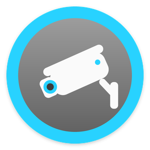
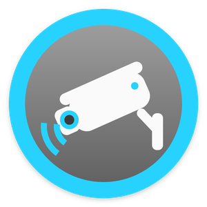
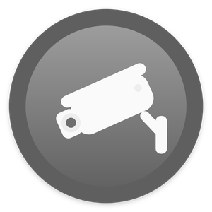
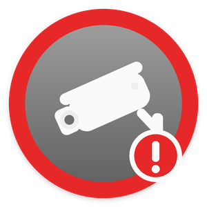
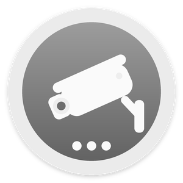

# DirectorLink · UniFi Protect for Control4

Free, open-source Control4 driver for UniFi Protect cameras and doorbells. Part of [DirectorLink Drivers](https://directorlink.io/drivers).

It works on your local network: the drivers talk straight to your UniFi console with Ubiquiti's official Protect Integration API, with no cloud, no extra hardware and no subscription.

Free. No subscription, no license key, no account with us.

Made by [DirectorLink](https://directorlink.io), the open-source management layer for Control4 homes. Works on its own: DirectorLink is not required.

DirectorLink is an independent project, not affiliated with Control4 or Snap One.

**Download:** [latest release](../../releases/latest) · **Help and updates:** [directorlink.io/drivers/unifi-protect](https://directorlink.io/drivers/unifi-protect)

> **Field reports wanted.** The drivers follow Ubiquiti's published API exactly and pass their tests against recorded API answers, but no installer has reported on them from a real UniFi system yet. If you install them, please send the log: see [Field reports](#field-reports).

|  |  |  |  |  |
|:---:|:---:|:---:|:---:|:---:|
| Alerts on | Alert | Alerts off | Console or camera offline | Working |

## Features

| Feature | Control4 app | Programming |
|---|---|---|
| Add every camera and doorbell | Nothing to do: they appear, named as in UniFi Protect | Hub action: Add New Cameras |
| Pictures | Camera tiles and the camera view | Notification snapshots |
| Live video | The camera view, from the console's RTSP or RTSPS stream | — |
| Smart detections: person, vehicle, animal, package, face, license plate, line crossing, zone (intrusion), motion | — | Events, variables, conditionals and contacts on each camera |
| Doorbell rings (G4 Doorbell, G4 Doorbell Pro, G6 Entry) | Notifications with a snapshot | *Ring* (camera) and *Doorbell Ring* (hub) events, `LAST_RING` |
| Alerts for people: any detection, people and vehicles, or people only | Notifications with a snapshot | *Alert* (camera) and *Camera Alert* (hub) events, `LAST_ALERT` |
| One alerts tile for the home | Tap to turn alerts on or off. The icon shows alert, off, snoozed or offline | `SET_ALERTS`, `SNOOZE_ALERTS`, *Alerts On/Off* events |
| Sounds the camera listens for (smoke alarm, glass break, ...) | — | *Sound Detected*, `LAST_SOUND` |
| Health | The tile shows a console or camera that is offline | *Console Offline/Online*, *Camera Offline/Online* events |

## Requirements

- **Control4 OS 3.3.0 or newer** and Composer Pro. **Live video needs OS 3.3.2 or newer**: Control4 added the stream API the driver uses in 3.3.2. On 3.3.0 and 3.3.1 pictures, alerts and rings work, and the camera's *Attention* line says so.
- **A UniFi console running UniFi Protect 5.3 or newer**: Dream Machine (Pro, SE, Pro Max), UNVR, UNVR Pro, Cloud Key Gen2 Plus, and the other consoles that run Protect. Protect 5.3 brought the Integration API. The drivers use only parts of it that are the same in every documented version, 5.3.48 to 6.2.83, and refuse an older Protect with a clear message.
- **An API key** made on the console (see [Setup](#setup)). No UniFi username or password is needed.
- The console reachable from the Control4 controller (port 443).
- **H.264 video.** Control4 plays H.264. If *Enhanced Encoding* (H.265) is on for a camera in UniFi Protect, turn it off.

## Installation

There are two drivers. Install both:

| Driver in Composer | File | What it does |
|---|---|---|
| **DirectorLink · UniFi Protect** | `DirectorLink-UniFi-Protect.c4z` | Add it **once** per console. It connects to the console, adds its cameras, serves their pictures, passes on their events and gives the home one alerts tile. It shows in the project as **UniFi Protect Hub**. |
| **DirectorLink · UniFi Protect Camera** | `DirectorLink-UniFi-Protect-Camera.c4z` | One per camera or doorbell, added by the hub. Pictures, live video, detections, alerts, rings and programming. |

1. Download both `.c4z` files from the [latest release](../../releases/latest).
2. In Composer Pro: **Driver → Add or Update Driver or Agent**, once for each file.
3. Search **DirectorLink** and add **DirectorLink · UniFi Protect** to the room where new cameras should appear, for example a "Cameras" room.

> **Keep the exact file names.** If your browser saves a second copy as `DirectorLink-UniFi-Protect (1).c4z`, rename it before you upload. Composer knows a driver by its file name, so a renamed copy installs as a separate driver instead of updating the one you have.

## Setup

### All cameras in three steps

1. **Make an API key.** In the UniFi console (the web page or the UniFi app): **Settings → Control Plane → Integrations → Create API Key**. Copy the key.
2. **Connect the hub.** In the **UniFi Protect Hub** properties, enter **Console Address** (the console's IP address, for example `192.168.50.1`) and paste the **API Key**. **Status** says *Connected*, **Console** shows the Protect version, and **Found On Console** lists what it found, for example *5 cameras, 1 doorbell - 6 not added yet*.
3. **Add them.** Run **Actions → Add New Cameras**, then drag each camera to its room.

Optional: add the **UniFi Protect Hub** to a room menu, for example *Security*, in Navigator settings, and rename it to something like **Camera Alerts** so the family knows what the tile does.

### Live video: RTSP or RTSPS

The hub's **Live Video** chooses which of the console's streams Control4 plays:

| Live Video | Stream | |
|---|---|---|
| **RTSP (port 7447)** (default) | `rtsp://<console>:7447/<token>` | **Try this first.** It is what Control4 apps play best. The video is not encrypted on the home network. |
| **RTSPS (port 7441)** | `rtsps://<console>:7441/<token>?enableSrtp` | Encrypted, but Control4 apps may not play it. Try it if you want encryption, and go back to RTSP if the video stops. |

Each camera has High, Medium and Low streams; **Video Quality** (Auto) gives small tiles the Low stream and full screen the High one. UniFi Protect has RTSP off for new cameras. With **Create Streams** on *Automatic* (the default) the hub switches on the streams of a camera that has none, which is the same as turning on RTSP for it in UniFi Protect.

### Pictures

Control4 apps and DirectorLink take a camera's pictures from its Control4 camera **Properties** page: address, port, login and snapshot path. The console only answers with the API key, which they cannot send, so the hub runs a small **picture server** on the controller (port **47080**, see **Picture Server**). Each camera's page points at it, with that camera's own random **Basic** login. The hub fetches each picture from the console with the key and keeps it at most one second. A request with another camera's login, or no login, is refused.

Do not change the address, port or login on a camera's Properties page: the hub owns them and the driver puts them back.

### Alerts

**Detections** always fire their events, variables and contacts. Use them for automations, such as lights on when a person is detected at night.

**Alerts** are the part meant for people: the *Alert* and *Camera Alert* events, notifications, snapshots and the Control4 History. A detection becomes an alert when alerts are on for that camera **and** on the hub (its tile), are not snoozed, no alert is already active (**Hold Time**, 30 s by default, so one event alerts once), **and** the detection matches the camera's **Alert On**:

| Alert On | Alerts for |
|---|---|
| Any detection | everything the camera reports, motion included |
| People and vehicles | person, face, vehicle, license plate |
| People only | person, face |

Smart detections (person, vehicle, ...) need the camera's smart detections switched on in UniFi Protect.

With **Snapshot With Alerts** on *Yes* (the default), *Alert*, *Ring*, *Camera Alert* and *Doorbell Ring* wait up to 1.5 seconds for that camera's picture, so a notification always shows the picture of its own alert or ring. Set it to *No* for events without any wait (and without a picture).

### Doorbells

G4 Doorbell, G4 Doorbell Pro and G6 Entry are cameras with a ring. Each press sets `LAST_RING` (the time, ISO 8601 UTC) and fires *Ring* on the camera and *Doorbell Ring* on the hub, whatever the alert settings. A camera is a doorbell when the console says so, or from its first ring; set **Camera Type** to *Doorbell* to say so yourself.

### Settings

**UniFi Protect Hub**

| Property | |
|---|---|
| Status · Console · Cameras · Found On Console | What the hub is doing; the console and its Protect version; the cameras in the project; the cameras on the console |
| Event Connection · Picture Server · Last Error | The console's event stream; the picture server; the last thing that went wrong, with its time |
| Console Address · API Key | The console's IP address and the API key |
| Live Video · Create Streams | RTSP (default) or RTSPS; switch on missing streams |
| Ignored Cameras · Picture Server Port | Names or ids that Add New Cameras skips; the picture server's port (47080) |
| Alerts · Default Alert On · Snapshot With Alerts | Master switch; Alert On for new cameras; snapshot for notifications |
| Log Level | Also sets every camera's Log Level |

**Actions:** Connect Now · Add New Cameras · Update Camera Names · Send Settings To Cameras · Print Diagnostics

**UniFi Protect Camera**

| Property | |
|---|---|
| Camera Enabled · UniFi Camera · Camera Type | *No* stops events, alerts and pictures; the UniFi camera it shows (type a name to link a camera added by hand); Automatic, Camera or Doorbell |
| Status · Attention · Camera · Video · Pictures · Last Event · Managed By | Health in plain words, what to fix, kind and UniFi id, the live video and its streams, where pictures come from, the last event, the hub |
| Alerts · Alert On · Hold Time (s) | This camera's alerts, the alert filter, how long one alert lasts |
| Snapshot With Alerts · Record Alerts In History | Snapshot for notifications; Control4 History entries |
| Video Quality · Contact State When Active · Log Level | Auto / High / Medium / Low; Advanced |

**Actions:** Reconnect · Test Picture · Setup Report

## With DirectorLink

From DirectorLink 1.10, the DirectorLink app shows these cameras and doorbells with their pictures, their alerts and their doorbell rings. Nothing needs to be set up: the camera driver follows the [DirectorLink camera agreement, version 1](https://github.directorlink.io/blob/main/docs/CAMERA_DRIVERS.md), so DirectorLink recognizes it by what it says, not by its file name.

- Every camera driver sets `DIRECTORLINK_CAMERA` = `1`, `DIRECTORLINK_CAMERA_KIND` = `camera` or `doorbell`, and `DIRECTORLINK_CAMERA_EVENTS` = `Alert=1` (a camera) or `Alert=1,Ring=2` (a doorbell): the ids of its *Alert* and *Ring* events in driver.xml, so DirectorLink finds them without reading driver.xml. They are written on every start and follow the kind.
- An alert (after the camera's Alert On, the hub's alerts switch, snooze and Hold Time) sets `LAST_ALERT` to what it saw (Person, Vehicle, Animal, Package, Face, License Plate, Line Crossing, Intrusion, Motion), then fires the event *Alert*: once per alert.
- A doorbell press sets `LAST_RING` to the time (ISO 8601 UTC, a new value for every ring), then fires the event *Ring*. A camera whose kind is `camera` (Camera Type set to *Camera*) never fires *Ring*.

DirectorLink takes the pictures the way Control4 apps do, from the camera's Properties page and the hub's picture server, so the API key never leaves the controller. Without DirectorLink the drivers work the same.

## Programming examples

- **One notification for every camera.** On the hub: *When* **Camera Alert** → *Send notification* "`LAST_ALERT_TYPE` at `LAST_ALERT_CAMERA`" with the attachment **Snapshot from the camera that raised the alert or rang**.
- **The doorbell.** On the hub: *When* **Doorbell Ring** → announce "Someone at `LAST_RING_CAMERA`" and show the camera on the touchscreens.
- **Alerts follow the alarm.** When the security system arms, run hub `SET_ALERTS On`. When it disarms, run `SET_ALERTS Off`. `SNOOZE_ALERTS` pauses alerts for a number of minutes.
- **Lights for people at night.** On a camera: *When* **Person Detected**, *if* it is dark, turn on the porch lights. This runs even when alerts are off.
- **Tell the installer.** On the hub: *When* **Console Offline** or **Camera Offline** → send a notification with `LAST_OFFLINE_CAMERA`.

### Reference

**UniFi Protect Hub**

- **Events:** Camera Alert · Doorbell Ring · Camera Offline · Camera Online · Alerts On · Alerts Off · New Cameras Found · Console Offline · Console Online
- **Variables:** `ALERTS_ENABLED` `ALERT_ACTIVE` `ALL_ONLINE` `CONSOLE_ONLINE` (BOOL) · `CAMERAS_TOTAL` `CAMERAS_ONLINE` (NUMBER) · `LAST_ALERT_CAMERA` `LAST_ALERT_TYPE` `LAST_ALERT_TIME` `LAST_RING_CAMERA` `LAST_RING_TIME` `LAST_OFFLINE_CAMERA` `PROTECT_VERSION` (STRING)
- **Conditionals:** Camera alerts are On/Off · An alert is Active/Clear · All cameras are Online · The console is Online · Last alert is &lt;type&gt;
- **Commands:** `SET_ALERTS` (On/Off/Toggle) · `SNOOZE_ALERTS` (minutes) · `REFRESH`
- **Notification attachments:** snapshot from the camera that raised the alert or rang · live snapshot from that camera (a link with a 10-minute token)

**UniFi Protect Camera**

- **Events:** Alert · Ring · Motion Detected · Motion Ended · Person Detected · Vehicle Detected · Animal Detected · Package Detected · Face Detected · License Plate Detected · Line Crossing · Intrusion Detected · Sound Detected · Camera Online · Camera Offline · Alerts On · Alerts Off
- **Variables:** `DIRECTORLINK_CAMERA` `DIRECTORLINK_CAMERA_KIND` `DIRECTORLINK_CAMERA_EVENTS` `LAST_ALERT` `LAST_RING` `LAST_ALERT_TIME` `LAST_DETECTION` `LAST_SOUND` (STRING) · `ONLINE` `ALERTS_ENABLED` `ALERT_ACTIVE` `MOTION` `PERSON` `VEHICLE` `ANIMAL` `PACKAGE` `FACE` `LICENSE_PLATE` `LINE_CROSSING` `INTRUSION` `RINGING` (BOOL)
- **Conditionals:** Camera is Online · Alerts are On · Alert is Active · Motion is Active · Active detection is &lt;type&gt; · Last alert is &lt;type&gt; · This camera is a Doorbell
- **Commands:** `SET_ALERTS` · `SNOOZE_ALERTS` · `SET_ALERT_ON`
- **Contacts** (Connections → Control): Alert · Motion · Person · Vehicle · Animal · Package · Doorbell. Bind them to Control4 motion or contact sensor devices.
- **Notification attachment:** snapshot at the last alert or ring

## Updating

1. Download the new `.c4z` files from the [latest release](../../releases/latest).
2. Check that the names are exactly `DirectorLink-UniFi-Protect.c4z` and `DirectorLink-UniFi-Protect-Camera.c4z`, not `... (1).c4z`.
3. **Driver → Add or Update Driver or Agent** for each. Cameras keep their settings, rooms and programming.

## Troubleshooting

| What you see | What to do |
|---|---|
| "The console refused the API key" | Make a new key in **Settings → Control Plane → Integrations** and paste it into **API Key**. |
| "UniFi Protect ... is too old" or "no UniFi Protect Integration API" | Update UniFi Protect on the console to 5.3 or newer. |
| "Cannot reach the console" | **Console Address** must be the console's IP (not a camera's), reachable from the controller on port 443. |
| "Could not add the camera driver" | Upload `DirectorLink-UniFi-Protect-Camera.c4z` (Driver → Add or Update Driver or Agent), then run **Add New Cameras** again. |
| No pictures | Check the hub's **Picture Server**. If the port is in use, choose another **Picture Server Port**. Run **Test Picture** on the camera: it fetches the picture exactly as Control4 apps do. |
| Pictures, but no live video | Control4 OS 3.3.2 or newer is needed. Try the other **Live Video** setting. Turn off *Enhanced Encoding* (H.265) for the camera in UniFi Protect. Check the camera's **Video** line lists streams. |
| No events or alerts | Check the hub's **Event Connection** says *Live*, and the camera's smart detections are on in UniFi Protect. For *Alert*, check alerts are on and the camera's **Alert On**. |
| A doorbell shows as a camera | It becomes a doorbell at its first ring, or set **Camera Type** to *Doorbell*. |
| No tile or no camera controls | Add the **UniFi Protect Hub** to a room menu, and refresh Navigator after installing or updating. |

For details, run **Print Diagnostics** on the hub and **Setup Report** on a camera, with **Log Level** set to *Debug*.

## Field reports

These drivers have not yet been reported working on a real UniFi system. If you install them:

1. Set the hub's **Log Level** to **Debug** (this also sets every camera's).
2. Run **Add New Cameras**, then **Print Diagnostics** on the hub and **Test Picture** on one camera and one doorbell.
3. Open a camera on a touchscreen and in the Control4 app (pictures, then live video with **Live Video** on RTSP, then on RTSPS), walk in front of a camera, and press the doorbell.
4. Send the controller's driver log (`driver_log.log`, or the Lua tab output) in an [issue](../../issues).

Every line of the drivers starts with `UniFi Protect Hub:` or `UniFi Protect Camera '<name>':`. At *Debug* the log shows every API request (status and time), every WebSocket message, every picture request and every event. It never shows the API key, stream tokens or picture passwords. **Print Diagnostics** lists the console's Protect version, the API's answer for every camera (names, ids, models, kinds, streams, and the fields the console sends), the event connection and the last 10 events.

**Not confirmed on a real system yet:** pictures on touchscreens, the app and DirectorLink; live video over RTSP and RTSPS; alerts and doorbell rings from a real console. **Not expected to work yet:** live video and pictures away from home (over 4Sight), since the stream and picture addresses are the home network's; audio; PTZ.

## Privacy

The drivers talk only to the UniFi console on your home network. They send nothing to DirectorLink or to Ubiquiti's cloud and collect no usage data.

The API key stays in your Control4 project and goes only to the console you enter. Reports and logs never show the API key, stream tokens or picture passwords.

## Support

Community-supported, best effort. Report problems in [Issues](../../issues).

Please include the console model, its UniFi Protect version, the camera models, your Control4 OS version, each driver's **Driver Version**, the **Print Diagnostics** and **Setup Report** output, and the log with **Log Level** set to *Debug*. Remove addresses and names you don't want to share. Reports that a model works are welcome too. Security problems: see [SECURITY.md](SECURITY.md).

## Building from source

```
pip install lupa pillow
python tools/gen_hub_xml.py      # after editing tools/hub_driver.xml.in
python tools/make_icons.py       # after changing icons
cd tests && python test_static.py && python test_xml.py && python test_protocol.py && python test_hub.py && python test_camera.py && python test_integration.py && cd ..
python tools/build.py            # -> dist/DirectorLink-UniFi-Protect.c4z, dist/DirectorLink-UniFi-Protect-Camera.c4z, dist/SHA256SUMS.txt
```

`test_static.py` needs `luac` 5.1 (`apt install lua5.1`). `python tools/check_fixtures.py` (with `pip install jsonschema`) checks the recorded API answers against Ubiquiti's OpenAPI specifications for Protect 5.3.48, 6.0.53, 6.1.79 and 6.2.83, downloaded from developer.ui.com.

| Path | Contents |
|---|---|
| `src/common/core.lua` | Shared core: logging with secret redaction, timers, variables and events, utilities |
| `src/hub/json.lua` | JSON decoder and encoder |
| `src/hub/websocket.lua` | WebSocket client (RFC 6455) over a Control4 SSL network connection |
| `src/hub/protect.lua` | Protect Integration API client: one host, the key in a header, no redirects, a request queue, 429 back-off |
| `src/hub/pictures.lua` | The picture server on the controller (C4:CreateTCPServer) |
| `src/hub/`, `src/camera/` | The drivers: `driver.lua`, `driver.xml` (the hub's is generated), `www/` documentation and icons |
| `tools/` | `build.py`, `gen_hub_xml.py` + `hub_driver.xml.in`, `make_icons.py`, `check_fixtures.py` |
| `tests/` | `harness.py` (Lua 5.1 with a stubbed Control4 API), `fake_console.py` (the console, from `fixtures/`), and the tests |
| `VERSION`, `CHANGELOG.md`, `docs/releases/` | The version, the change log, and the notes for each release |

`build.py` puts the Lua parts in front of each driver's `driver.lua` and stamps the version from `VERSION` and the build date into the packaged copies. The driver version Composer compares is major·1000000 + minor·10000 + patch·100 + build, where build is the beta number, or 99 for the release: `1.0.0-beta.1` → `1000001`, `1.0.0` → `1000099`. So each beta and the release after it count up.

The tests run the real driver code in Lua 5.1. The console is played by `fake_console.py` with recorded answers in the shape of Ubiquiti's OpenAPI schema (made-up values). They cover the connection and version checks, the API key going only to the console, redirects, rate limits, adding cameras, doorbells, streams, the WebSocket (handshake, framing, ping, close), event routing, the picture server (logins, the one-second picture, shared fetches), the camera page, stream URLs for Navigators, the alert filter, Hold Time, rings, the DirectorLink camera agreement, both drivers together end to end, and that no log line shows a secret.

**How it works**

- **API:** `GET /v1/meta/info` (Protect version, refused below 5.3), `/v1/nvrs`, `/v1/cameras`, `/v1/cameras/{id}/snapshot[?highQuality=true]`, `GET` and `POST /v1/cameras/{id}/rtsps-stream`, and the WebSockets `/v1/subscribe/events` and `/v1/subscribe/devices`, all under `https://<console>/proxy/protect/integration/v1` with `X-API-Key`. `C4:url` follows redirects by itself and would carry that header along, so an `OnHeaders` callback stops any 3xx answer before it is followed.
- **Adding:** `C4:AddDevice("DirectorLink-UniFi-Protect-Camera.c4z", room, name, callback)`. The new camera then receives `DL_CONFIGURE` through `C4:SendToDevice` (not logged by Director: it carries the picture login).
- **Camera page:** address = `C4:GetControllerNetworkAddress()`, HTTP port = the picture server, Basic login; written with the commands Composer uses and checked with `GET_PROPERTIES`.
- **Video:** the camera declares `requires_dynamic_stream_urls`, and answers `GET_STREAM_URLS` with the console's stream (RTSP or RTSPS) for the requested resolution.
- **Hub ↔ camera messages:** `DL_CONFIGURE`, `DL_STREAMS`, `DL_STATE`, `DL_EVENT`, `DL_HUB_ALERTS`, `DL_HUB_HELLO`, `DL_LOG_LEVEL`, `DL_CLAIM_FAILED` (hub → camera); `DL_CAMERA_STATUS`, `DL_CAMERA_ALERT`, `DL_CAMERA_RING` (camera → hub).
- **Requests** identify themselves with the User-Agent `DirectorLink-UniFi-Protect/<version>` (hub) or `DirectorLink-UniFi-Protect-Camera/<version>` (camera).

**Rules for new versions**

- `VERSION` is the only place the version is set.
- **Never rename** the `.c4z` files, and **never change or remove** proxy binding ids, the order of variables, event and command ids, or property names. Dealers' projects (and DirectorLink) depend on them. Adding new ones is fine, after the existing ones. If the ids of *Alert* (1) or *Ring* (2) ever change, `DIRECTORLINK_CAMERA_EVENTS` must say the new ones.
- Update `VERSION`, `CHANGELOG.md`, the change log in both `www/documentation.html` files, and `docs/releases/v<version>.md`. Then tag `v<version>`: GitHub Actions tests, builds and publishes the release with `SHA256SUMS.txt` (a pre-release for `-beta` versions).

## License and trademarks

[Apache License 2.0](LICENSE). See also [NOTICE](NOTICE).

The UniFi Protect Integration API is used as Ubiquiti documents it at [developer.ui.com](https://developer.ui.com). How the Control4 camera proxy behaves in the field was learned from the open-source [C4-UnifiProtect](https://github.com/efic1/C4-UnifiProtect) drivers. No code was copied from them. Control4 interfaces follow the public [Snap One DriverWorks documentation](https://snap-one.github.io/docs-driverworks-fundamentals/). DirectorLink's own source code: [github.directorlink.io](https://github.directorlink.io).

Installing third-party drivers or changing a Control4 project can affect compatibility, support, warranty or recovery. Keep a backup of your project.

Apache License 2.0. Copyright 2026 DirectorLink. DirectorLink is an independent project, not affiliated with Control4 or Snap One. Not affiliated with or endorsed by Ubiquiti. Product names are trademarks of their owners.
